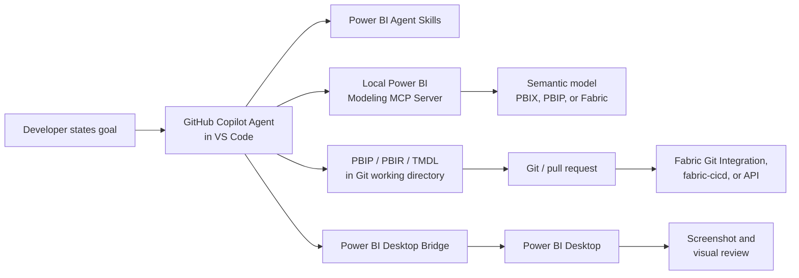
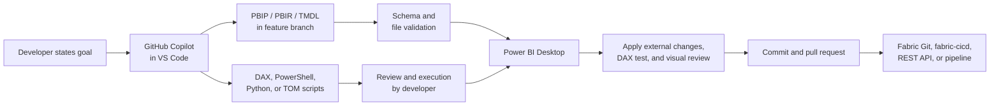

# Vibe Coding with Power BI on Windows

## Training material for Visual Studio Code, Visual Studio, and agentic BI development

> **As of:** August 19, 2026  
> **Target platform:** Windows 10/11 with Power BI Desktop  
> **Audience:** Power BI developers, BI architects, data analysts, DevOps professionals, and technical trainers  
> **Product status notice:** Several of the features described are in preview. Check their status on the linked Microsoft Learn pages before each training session.

## 1. Executive summary

Vibe coding with Power BI is possible on Windows. Microsoft does not use **Vibe Coding** as an official product name in its Power BI documentation. However, **Power BI Agentic**, **GitHub Copilot**, the **Power BI MCP servers**, **Power BI Desktop Projects (PBIP)**, **PBIR**, **TMDL**, and the **Power BI Desktop Bridge** now provide an agentic development workflow documented by Microsoft.

If a customer cannot or is not permitted to use MCP servers, a limited, file-based approach to vibe coding is still possible. VS Code or Visual Studio, GitHub Copilot, PBIP, PBIR, TMDL, DAX, Power BI Desktop, Git, and CI/CD all work without MCP. What is unavailable is direct agent access to the semantic model through the local Modeling MCP Server, as well as natural-language model queries through the remote MCP Server. Section 7.5 describes the recommended target state without MCP.

A business requirement can be expressed in natural language. An AI agent can then:

1. inspect a semantic model,
2. create or modify tables, relationships, and measures,
3. run DAX queries and check the results,
4. create report pages and visuals in PBIR,
5. reload Power BI Desktop,
6. capture screenshots for visual review,
7. track changes through Git, and
8. deploy artifacts to Microsoft Fabric in a controlled manner.

The recommended workstation is more than just an editor. The tools serve different purposes:

- **Power BI Desktop** renders reports, processes local models, and remains the visual review and authoring interface.
- **Visual Studio Code** is the preferred environment for AI agents, MCP, PBIP/PBIR/TMDL, Git, scripts, and CI/CD files.
- **Visual Studio with SSDT** is a specialized development environment for Analysis Services tabular models and their deployment, but it is not a Power BI report designer.

## 2. Learning objectives

After completing this material, participants will be able to:

- apply the concept of vibe coding to Power BI and put it into context,
- distinguish Visual Studio Code from Visual Studio for Power BI scenarios,
- explain the roles of PBIX, PBIP, PBIR, and TMDL,
- distinguish local and remote Power BI MCP servers,
- plan an agentic change workflow with controlled approval gates,
- write suitable prompts for model, DAX, and report development,
- assess the Power BI Desktop Bridge for reload and visual validation,
- describe Git and CI/CD practices for Power BI projects, and
- assess preview, security, and quality risks.

## 3. What does vibe coding mean for Power BI?

### 3.1 Working definition

In this material, **vibe coding with Power BI** means:

> An AI-assisted development process in which the developer describes goals, business rules, and quality criteria primarily in natural language, and an agent uses that input to produce verifiable changes to a semantic model, DAX, a report, or deployment automation.

The result is still software or metadata and must therefore be treated like other code: versioned, reviewed, tested, approved, and monitored.

### 3.2 What vibe coding does not mean

Vibe coding does not mean:

- sending an unclear prompt straight to production,
- checking business DAX results only for syntactic validity,
- accepting AI-generated visuals without visual review,
- delegating permissions, RLS, or privacy to the agent,
- inventing PBIR JSON from memory without schema or tool support, or
- replacing Power BI Desktop entirely with Visual Studio Code.

### 3.3 Maturity by task

| Task | Suitability for agentic work | Rationale |
| --- | --- | --- |
| Generate measures and DAX queries | High | Structured language, executable tests, and clear model context |
| Add descriptions, format strings, and metadata | High | Changes are easy to automate and repeat |
| Change tables, relationships, and perspectives | Medium to high | Works well with TMDL/MCP, but requires business-level model review |
| Make bulk changes across many model objects | High | Bulk operations and transactions are core use cases for the local MCP Server |
| Make a targeted change to an existing PBIR page | Medium to high | Public schemas and the Authoring Skill enable controlled changes |
| Design a report from scratch | Medium | An agent can plan and build it, but layout, readability, and narrative must be visually reviewed |
| Generate Power Query transformations | Medium | Technically possible, but data profiling, folding, and privacy must be checked |
| Business approval and KPI definition | Low | Responsibility remains with the business team and data owner |
| Production deployment without review | Not recommended | Preview features and destructive agent operations require approval |

## 4. Windows as the recommended development platform

Power BI Desktop runs on Windows. This allows the complete local agent cycle to take place on one computer:



### 4.1 Minimum Power BI Desktop requirements

Microsoft lists requirements that include:

- Windows 10 or Windows Server 2016 or later,
- .NET Framework 4.7.2 or later,
- Microsoft Edge or WebView2,
- at least 2 GB of available RAM, with 4 GB or more recommended,
- a screen resolution of at least 1440 × 900 or 1600 × 900, and
- a 64-bit processor.

For training computers, Windows 11 with at least 16 GB of RAM is advisable, particularly when Power BI Desktop, VS Code, Git, Node.js, and a browser are running at the same time.

### 4.2 Recommended software

| Component | Purpose | Requirement |
| --- | --- | --- |
| Power BI Desktop | Modeling, report canvas, rendering, and publishing | Required for the complete local workflow |
| Visual Studio Code | Agent, MCP, files, Git, scripts, and validation | Recommended |
| Git | Version control, branches, diffs, and rollback | Strongly recommended |
| GitHub Copilot | Agentic interaction in VS Code | Required for the Copilot workflow described here |
| GitHub Copilot CLI | Installing and using the Power BI Authoring plugin | Required for the recommended plugin approach |
| Node.js 18 or later | Prerequisite for the Authoring plugin | Required according to the Power BI Agentic documentation |
| Node.js 20 or later | Running the local MCP Server through `npx` | Required for this installation method |
| TMDL extension for VS Code | TMDL syntax support | Recommended |
| Visual Studio with Analysis Services Projects | Classic tabular/SSDT projects | Only for applicable enterprise scenarios |
| DAX Studio, ALM Toolkit, or Tabular Editor | Diagnostics, comparison, and advanced modeling | Optional |

## 5. Comparing Visual Studio Code and Visual Studio

### 5.1 Decision matrix

| Criterion | Visual Studio Code | Visual Studio with SSDT |
| --- | --- | --- |
| Primary role | Lightweight code editor and agent host | Integrated development environment for Analysis Services |
| GitHub Copilot Agent and MCP | Central, Microsoft-documented Power BI Agentic path | MCP is generally supported, but this is not the primary documented Power BI Agentic path |
| PBIP project files | Very well suited | Not a focus |
| PBIR report files | JSON schema, IntelliSense, Agent Skills, and Git | No Power BI report designer |
| TMDL | Official Microsoft TMDL extension and text-based editing | Tabular model through SSDT/Model Designer, traditionally `model.bim` |
| Designing Power BI report pages | Indirectly through PBIR and Agent Skills; review in Desktop | Not supported |
| Designing semantic models | TMDL, MCP, scripts, and external tools | Full Tabular Model Designer for Analysis Services Projects |
| Connecting to Power BI Desktop | Modeling MCP and Desktop Bridge | XMLA/Analysis Services and classic external toolchains |
| Target systems | Power BI Desktop, PBIP, Fabric workspaces | SSAS, Azure Analysis Services, and Power BI Premium through XMLA |
| Source control | Native Git interface, well suited to small text files | Azure DevOps/Git for SSDT solutions |
| CI/CD files | YAML, Python, PowerShell, Fabric CLI, and `fabric-cicd` | Build/deployment of classic Analysis Services projects |
| Typical user | Power BI developer, analyst, analytics engineer | BI/Analysis Services developer |
| Recommendation for vibe coding | **Preferred interface** | Supplement for specialized tabular enterprise scenarios |

### 5.2 When should you use Visual Studio Code?

Visual Studio Code is the right choice if at least one of the following applies:

- Power BI artifacts are to be stored in Git as PBIP.
- An AI agent is to edit TMDL, DAX, or PBIR.
- The local or remote Power BI MCP Server is to be used with GitHub Copilot.
- JSON schemas are to validate PBIR files.
- Bulk changes or cross-project searches are required.
- Deployment scripts in Python, PowerShell, or YAML are part of the project.
- Pull requests should show readable text diffs for the model and report.

### 5.3 When should you use Visual Studio?

Visual Studio with the **Analysis Services Projects** extension is useful when:

- developing a standalone Analysis Services tabular model,
- targeting SQL Server Analysis Services or Azure Analysis Services,
- deploying a tabular model directly to a Power BI Premium/Fabric workspace through XMLA,
- working with an established SSDT project containing `model.bim`, configurations, and a build process, or
- the team already operates an established Visual Studio/Azure DevOps toolchain.

For deployment to Power BI Premium, Microsoft documents:

- Visual Studio 2017 or later,
- Analysis Services Projects Extension 2.9.14 or later,
- model compatibility level 1500 or later,
- XMLA read/write access enabled in the workspace, and
- the workspace connection URL as the deployment server.

After the first metadata deployment, data source credentials must be configured in the Power BI Service. According to Microsoft, direct **Deploy** from Visual Studio should not be used as a general production process because it can overwrite properties of an existing model.

### 5.4 The key difference

In this scenario, Visual Studio and Visual Studio Code are not interchangeable versions of the same tool:

- **Visual Studio Code is file-, agent-, and automation-oriented.**
- **Visual Studio is project-, designer-, and Analysis Services-oriented.**

For modern Power BI training on vibe coding, VS Code should be the primary tool. Visual Studio should be included as a point of comparison and as an advanced option for centrally managed semantic models.

## 6. Understanding Power BI artifacts

### 6.1 PBIX

A `.pbix` file bundles the report, model, and, where applicable, imported data. It works well with Power BI Desktop, but is poorly suited to line-based Git diffs and parallel editing.

### 6.2 PBIP

A Power BI Project (`.pbip`) stores the report and semantic model in a readable folder structure. According to Microsoft, PBIP is currently in preview.

```text
SalesAnalytics/
├── SalesAnalytics.pbip
├── SalesAnalytics.Report/
│   ├── definition.pbir
│   └── definition/
│       ├── pages/
│       ├── bookmarks/
│       └── report.json
├── SalesAnalytics.SemanticModel/
│   ├── definition.pbism
│   └── definition/
│       ├── model.tmdl
│       ├── tables/
│       ├── relationships.tmdl
│       └── roles.tmdl
└── .gitignore
```

Power BI Desktop adds entries by default for local files that should not be versioned:

```gitignore
**/.pbi/localSettings.json
**/.pbi/cache.abf
```

### 6.3 TMDL

The **Tabular Model Definition Language** describes a semantic model as text. The TMDL view in Power BI Desktop is generally available; the web version is in preview.

TMDL is suitable for:

- measures, tables, columns, and relationships,
- calculation groups,
- perspectives and translations,
- roles and metadata,
- find-and-replace across many objects, and
- reusable model components.

Example of a perspective from Microsoft Learn:

```tmdl
createOrReplace
    perspective SalesView
        perspectiveTable Sales
            perspectiveMeasure 'Sales Amount'
            perspectiveMeasure 'Sales Qty'
            perspectiveColumn Quantity
            perspectiveColumn 'Amount'
```

### 6.4 PBIR

The **Power BI Enhanced Report Format** stores pages, visuals, and bookmarks in separate JSON files. PBIR is publicly documented and supports JSON schemas, making it suitable for IntelliSense, validation, diff, and merge. PBIR is currently in preview.

Typical automation use cases include:

- copying pages or visuals between reports,
- changing colors and formatting across many visuals,
- adjusting visual-level filters with a script,
- replacing outdated visual types, and
- generating reusable report templates.

PBIR should not be constructed from memory. For agentic changes, Microsoft recommends the **Power BI Report Authoring Skill**, which takes the schemas and file mechanics into account.

## 7. Components of the agentic Power BI stack

### 7.1 Power BI Agentic

Power BI Agentic is not a switch in Power BI Desktop. Microsoft describes it as a curated package of:

- Agent Skills that provide workflows and best practices, and
- tools for inspecting models, running DAX, editing PBIR, and controlling Desktop.

The recommended plugin is called `powerbi-authoring` and includes, among others:

| Skill | Purpose |
| --- | --- |
| `semantic-model-authoring` | Create, modify, deploy, and optimize models |
| `power-bi-report-design` | Design brief, page type, chart selection, color, and layout |
| `power-bi-report-planner` | Requirements, model analysis, plan, and approval gates |
| `powerbi-report-authoring` | PBIR pages, visuals, filters, themes, and validation |
| `power-bi-report-management` | Load and manage reports through Fabric APIs |

Install through GitHub Copilot CLI:

```powershell
copilot plugin marketplace add microsoft/skills-for-fabric
copilot plugin install powerbi-authoring@fabric-collection
```

After installation, use `/skills` in Copilot CLI to check whether, for example, `semantic-model-authoring` has loaded. In VS Code, you can find the plugin through the Agent Customization interface.

### 7.2 Local Power BI Modeling MCP Server

The local server is used to **create and modify** semantic models. It can work with:

- a model open in Power BI Desktop,
- Power BI project files, and
- semantic models in Fabric workspaces.

Core features according to Microsoft:

- natural-language commands for tables, columns, measures, and relationships,
- bulk operations with transactions and error handling,
- application of modeling best practices,
- TMDL and PBIP workflows, and
- execution and validation of DAX queries.

### 7.3 Remote Power BI MCP Server

The remote server is primarily used to **query and analyze** existing semantic models. It runs as a Fabric service and uses Microsoft Entra ID.

Workspace configuration in `.vscode/mcp.json`:

```json
{
  "servers": {
    "powerbi-remote": {
      "type": "http",
      "url": "https://api.fabric.microsoft.com/v1/mcp/powerbi"
    }
  }
}
```

Prerequisites:

- the Power BI administrator must enable the preview tenant setting,
- Visual Studio Code and GitHub Copilot,
- at least Build permission on the semantic model, and
- suitable Copilot permission or capacity for server-side DAX generation.

The server provides tools to retrieve the model schema and report metadata, generate DAX, and run DAX. Row-Level Security is enforced when using user authentication.

### 7.4 Power BI Desktop Bridge

The Desktop Bridge is a local server within the Power BI Desktop process. It communicates through a local Windows Named Pipe and JSON-RPC 2.0. Remote access is not supported.

The Bridge can:

- detect open Desktop instances and unsaved changes,
- open PBIP/PBIX,
- reload PBIR changes,
- capture individual or all report pages as PNG, and
- enable an agent's visual edit-and-review loop.

Important CLI commands:

```powershell
powerbi-desktop status
powerbi-desktop open .\SalesAnalytics.pbip
powerbi-desktop reload
powerbi-desktop screenshot <page-id>
powerbi-desktop screenshot-all
```

The **Enable external tool access to Power BI Desktop through secure local APIs** preview feature must be enabled in Power BI Desktop. According to Microsoft, it is enabled by default.

### 7.5 Customer environments without MCP servers

#### What is no longer available?

An MCP ban does not remove Power BI or AI assistance altogether. It removes the standardized connection through which an agent can discover and invoke Power BI tools.

| Capability | With MCP | Without MCP | Replacement or consequence |
| --- | --- | --- | --- |
| Automatically inspect model structure | Agent invokes model tools | No direct agent access | TMDL files, documented schema export, or manually provided context |
| Create measures directly in the open model | Local Modeling MCP Server | Not directly by the agent | Generate DAX/TMDL in VS Code, review it, and apply it in TMDL view or PBIP |
| Automatically run DAX against the model | MCP tool runs the query | No MCP call | DAX Query View, DAX Studio, XMLA, or an approved test script |
| Query data in natural language from VS Code | Remote MCP Server | Unavailable | Copilot in Power BI, DAX Query View, or manually run DAX queries |
| Generate PBIR files | Authoring Skill plus tools | Still possible with files | Public PBIR schemas, approved Skills without MCP, or controlled scripts |
| Reload a report in Desktop | Desktop Bridge | Unchanged, if the Bridge is allowed | **Apply external changes** banner as a fully manual alternative |
| Automate screenshots | Desktop Bridge | Unchanged, if the Bridge is allowed | Manual visual review and screenshots if the Bridge is also prohibited |
| Git diff and pull request | Independent of MCP | Unchanged | No replacement needed |
| Deployment | MCP is optional | Unchanged | Fabric Git Integration, `fabric-cicd`, REST API, or Deployment Pipeline |

#### Important: The Desktop Bridge is not an MCP server

According to Microsoft, the Power BI Desktop Bridge uses a local Windows Named Pipe and JSON-RPC 2.0. It does not implement the Model Context Protocol. Therefore, a ban on **MCP servers** does not automatically include the Bridge from a technical standpoint.

The customer's policy must still be clarified:

1. **Only MCP is prohibited:** After separate security approval, the Desktop Bridge may still be used for reloads and screenshots.
2. **All local agent or IPC services are prohibited:** Disable the Desktop Bridge; reload through **Apply external changes** and perform visual review manually.
3. **Autonomous write access is prohibited:** The agent may only produce suggestions or files in a feature branch; a human applies and approves the changes.

#### Recommended architecture without MCP



The agent primarily works on files. Power BI Desktop and approved domain tools remain the execution and review interfaces.

#### Recommended Windows tool stack without MCP

| Task | Preferred tool without MCP |
| --- | --- |
| Natural-language coding assistance | GitHub Copilot in VS Code or Visual Studio |
| Semantic model as code | PBIP and TMDL in VS Code |
| Change a model in the running Desktop | TMDL view or an approved external tool |
| Generate DAX | GitHub Copilot or Copilot in DAX Query View |
| Test DAX | DAX Query View, DAX Studio, or an approved XMLA query |
| Report as code | PBIR with JSON schemas and controlled scripts |
| Validate a report | JSON Schema, project-specific validation scripts, and Power BI Desktop |
| Reload a report | **Apply external changes** or an approved Desktop Bridge |
| Visual review | Power BI Desktop, with manual screenshots if needed |
| Version control | Git in VS Code or Azure DevOps |
| Deploy | Power BI Desktop, Fabric Git Integration, `fabric-cicd`, REST API, or Deployment Pipeline |
| Enterprise tabular model | Visual Studio with Analysis Services Projects/SSDT |

#### Do not install the Power BI Agentic plugin without review

The Microsoft `powerbi-authoring` plugin automatically registers the Power BI Modeling MCP Server. If MCP is prohibited, do not roll it out using the default installation without review.

Before using it, clarify whether:

- individual Agent Skills without the MCP component may be installed,
- the customer's policy allows Agent Customization files,
- PBIR changes should be made exclusively through custom, reviewed scripts, or
- report authoring should be limited to Power BI Desktop and Copilot in Power BI.

The conservative default is: **Do not install the plugin unless the MCP component can be demonstrably disabled or excluded.**

#### Workflow without MCP

1. Power BI Desktop saves a working version as PBIP.
2. Git secures the baseline in a commit.
3. The developer provides the agent with only the PBIP, TMDL, or PBIR files it needs as context.
4. The agent first creates a plan and diff, but does not execute Power BI operations itself.
5. TMDL/DAX is applied in TMDL view or DAX Query View and tested.
6. PBIR changes are schema-validated and loaded in Desktop using **Apply external changes**.
7. The developer visually reviews each report page and saves screenshots.
8. A pull request documents business tests, technical validation, and preview dependencies.
9. Deployment is performed through an approved non-MCP interface.

#### Example prompt without MCP

```text
You do not have direct access to Power BI Desktop, Fabric, or an MCP server.
Work only with the PBIP, TMDL, and PBIR files provided.

Task:
- Analyze the existing model structure from the TMDL files.
- Propose changes for [Sales Previous Year] and [Sales YoY %].
- Do not change relationships, roles, data sources, or Power Query expressions.
- Provide the TMDL/DAX changes and three DAX test queries.
- Do not claim that you ran the queries.
- State the expected results and manual review steps in Power BI Desktop.
- Wait for approval before changing any files.
```

This last point is important: without an execution tool, the agent must clearly distinguish between **generated**, **statically validated**, and **actually executed in the model**.

## 8. Recommended development workflow

### Phase 1: Requirements and acceptance criteria

Before writing the prompt, establish at least:

- the report's target audience,
- the business questions,
- KPI definitions,
- filter and time logic,
- security requirements,
- layout and accessibility requirements, and
- measurable acceptance criteria.

### Phase 2: Secure a baseline

1. Save the PBIX as PBIP.
2. Enable PBIR and TMDL where appropriate for the scenario.
3. Initialize the project in Git.
4. Commit the working starting point.
5. Create a feature branch for the agent's changes.

### Phase 3: Inspect the model

The agent should read first and report back:

```text
Inspect the open Power BI model. Do not make any changes yet.

Document:
- tables and granularity,
- relationships and filter directions,
- existing measures,
- date tables,
- roles and RLS,
- potential modeling issues,
- missing objects for the requested sales analysis.

Then create a change plan with risks and test cases.
```

### Phase 4: Make a small, verifiable change

```text
Implement only the Sales, Sales Previous Year, and Growth % measures.

Requirements:
- Use explicit measures.
- Use the existing marked date table.
- Set appropriate format strings and English descriptions.
- Do not change relationships or Power Query expressions.
- Run DAX test queries for total, month filter, and year-over-year comparison.
- Show the diff and test results before proceeding.
```

### Phase 5: Create or modify a report

```text
Create a PBIR page called "Management Overview" for the executive team.

Content:
- cards for Sales, Margin, and Growth %,
- monthly sales trend with prior-year comparison,
- Top 10 products as a horizontal bar chart,
- slicers for Year, Region, and Sales Channel.

Quality:
- Use only fields and measures that already exist in the model.
- Use the registered corporate theme.
- Avoid unnecessary visuals and scrolling at 16:9.
- Validate the PBIR structure.
- Reload the report in Power BI Desktop.
- Capture a screenshot and check for overlap, readability, and empty visuals.
```

### Phase 6: Technical and business validation

At a minimum:

- validate the PBIR/JSON schema,
- validate TMDL or the model,
- run DAX test queries with known expected values,
- check filter contexts,
- test RLS with suitable roles,
- check the performance of relevant visuals,
- review screenshots of all changed pages, and
- obtain business approval for the KPIs.

### Phase 7: Review and deployment

1. Review the Git diff.
2. Remove unintended changes.
3. Create a pull request with a business description and screenshots.
4. Run automated checks.
5. Deploy to a development or test workspace first.
6. Perform a smoke test and business acceptance.
7. Update production only after that.

## 9. Training exercises

### Exercise 1: Create and test DAX with local MCP

**Goal:** An agent adds three measures to a model open in Desktop.

**Starting point:** A star schema with `Sales`, `Date`, `Product`, and `Customer`.

**Prompt:**

```text
First analyze the model and identify the existing sales column
and the active relationship to the date table.

Then create:
1. [Sales]
2. [Sales Previous Year]
3. [Sales YoY %]

Use DIVIDE for the percentage calculation. Set format strings and
descriptions. Then run DAX queries for two selected years and explain
why the results are plausible.
```

**Review points:**

- Was the correct fact column used?
- Is the date table marked and contiguous?
- Does filter propagation work?
- Does the first year return no prior-year value, or a defined value, as expected?
- Are format strings and descriptions set?

**Without MCP:** The agent generates DAX and TMDL from the project files. Participants apply the changes in TMDL view and run the test queries themselves in DAX Query View. They then provide the results to the agent for analysis.

### Exercise 2: TMDL bulk change with plan approval

**Goal:** Hide technical keys and add descriptions.

**Prompt:**

```text
Inspect all model columns. Start by producing a proposal list only.

Candidates to hide are technical primary and foreign keys
whose names end in "Key", "ID", or "_SK". Do not hide identifiers
needed by the business. Do not change sourceColumn properties.

After I approve, create a transactional change and provide
a list of all modified objects.
```

**Learning point:** A broad prompt becomes controllable through a preview, exclusion rules, and approval.

### Exercise 3: Report with PBIR and Desktop Bridge

**Goal:** Create a new overview page and review it visually.

**Workflow:**

1. Provide the report as PBIP/PBIR.
2. The agent analyzes the model and existing theme.
3. The Report Design Skill creates a design brief.
4. The Report Authoring Skill creates the PBIR files.
5. `validate-report` checks the structure.
6. The Desktop Bridge reloads the files.
7. `screenshot` or `screenshot-all` captures images.
8. The agent and a human review the layout and business message.

**Review prompt:**

```text
Review the screenshot as an independent Power BI reviewer.

Assess:
- visual hierarchy,
- reading order,
- overlap and clipped text,
- consistent number formats,
- color contrast and accessibility,
- appropriate chart selection,
- empty or broken visuals,
- suitability for 1366 × 768 and 1920 × 1080.

First list specific findings. Do not change any files yet.
```

### Exercise 4: Remote MCP for data questions

**Goal:** Inspect a published model from VS Code without modifying it.

**Setup:** Configure the remote MCP Server and provide the model ID.

**Prompts:**

```text
What tables, relationships, and explicit measures are in the model
with ID <semantic-model-id>?
```

```text
Show the ten products with the highest sales in the last complete
quarter. First generate the DAX query, explain the filter context, and
then run it.
```

```text
Compare sales and margin by region with the same quarter last year.
Identify regions where sales are declining while margin is increasing.
```

**Learning point:** The remote server is an analysis tool. Model changes belong to the local Modeling MCP Server or other authoring interfaces.

**If MCP is prohibited:** Skip this exercise. Instead, answer the same business question using Copilot in DAX Query View or a DAX query generated by GitHub Copilot and then run manually. This also demonstrates the difference between code generation and controlled execution.

### Exercise 5: Deployment with `fabric-cicd`

Microsoft describes `fabric-cicd` as an officially supported, Microsoft-backed open-source Python library for code-based Fabric deployments.

Install:

```powershell
python -m pip install fabric-cicd
```

Typical project structure:

```text
my-powerbi-project/
├── SalesAnalytics.Report/
│   ├── definition.pbir
│   └── definition/
├── SalesAnalytics.SemanticModel/
│   ├── definition.pbism
│   └── definition/
├── SalesAnalytics.pbip
└── deploy.py
```

Invoke it using the pattern from Microsoft Learn:

```powershell
python .\deploy.py --workspace_name "PBIP Fabric CICD Dev"
```

For training, the pipeline should include at least these stages:

1. syntax and schema validation,
2. model and report review,
3. deployment to a development workspace,
4. smoke tests,
5. manual approval, and
6. deployment to test or production.

## 10. Prompt engineering for Power BI

### 10.1 A good prompt pattern

A reliable Power BI prompt includes:

1. **Role and goal:** Who will use the result, and what decision should it support?
2. **Context:** Which model, report, or files are in scope?
3. **Scope:** Which objects may be changed?
4. **Exclusions:** Which objects or properties must not be changed?
5. **Business rules:** Definitions, time logic, rounding, and edge cases.
6. **Quality criteria:** Format strings, naming conventions, performance, and accessibility.
7. **Validation:** Which queries, expected values, and screenshots are required?
8. **Approval gate:** When must the agent stop before proceeding with further changes?

### 10.2 Weak and improved prompts

Weak:

```text
Build me a good sales dashboard.
```

Improved:

```text
First create a design and implementation plan for a
16:9 report page for the sales leadership team. Do not change any files yet.

Business questions:
- How are sales and margin performing compared with last year?
- Which regions are missing their targets?
- Which products are driving the variance?

Use only explicit measures from the existing model. If measures are
missing, list them separately. Plan no more than six visuals, and account
for English number formats, color vision deficiency, and a clear reading order.

Define a business test case for each KPI. Then wait for my approval.
```

### 10.3 Safety prompt for existing projects

```text
Work only in the current feature branch.

Before each change:
- check the Git status,
- report unsaved changes in Power BI Desktop,
- create a plan and list the affected files.

Without explicit approval, do not:
- delete tables, measures, pages, or roles,
- change data sources or credentials,
- change RLS/OLS,
- publish to production workspaces,
- overwrite manual changes.

After each change:
- validate TMDL/PBIR,
- run the agreed DAX tests,
- generate a diff,
- reload Power BI Desktop and review screenshots.
```

## 11. Quality assurance

### 11.1 Model quality

- Check the star schema and unique granularity.
- Verify relationships, cardinality, and filter direction.
- Prefer explicit measures over implicit measures.
- Check the date table and time intelligence.
- Hide technical columns from the report interface.
- Standardize names, descriptions, folders, and format strings.
- Do not treat RLS/OLS and perspectives as interchangeable concepts.

### 11.2 DAX quality

- Check results against known values or SQL queries.
- Test grand totals and subsets.
- Test empty sets, division by zero, and the first comparison year.
- Ask for an explanation of the filter context and relationship path.
- Measure performance with realistic filters.
- Understand AI-generated code before adopting it.

Microsoft explicitly notes that Copilot-generated DAX must be validated and understood from a business perspective, even if it passes parser and syntax checks.

### 11.3 Report quality

- Validate PBIR structurally.
- Render every changed page and review it as a screenshot.
- Check for text overflow, overlap, and unreadable axes.
- Standardize number formats, units, and decimal places.
- Consider tab order, alt text, contrast, and color vision deficiency.
- Test filters, interactions, drillthrough, bookmarks, and mobile views.

### 11.4 Git review

The pull request should include:

- the business goal,
- affected model and report objects,
- before/after screenshots,
- DAX test cases and results,
- known limitations,
- preview dependencies, and
- rollback notes.

## 12. Security and governance

### 12.0 Governance when MCP is prohibited

An MCP ban reduces the number of direct agent tools and therefore the risk of autonomous model changes. However, it does not eliminate generative AI risks. PBIP, TMDL, and PBIR files can contain model names, KPI logic, roles, data source metadata, and other sensitive information.

Even without MCP, you must define:

- which project files GitHub Copilot may receive as context,
- whether cloud-hosted or only enterprise-managed models are permitted,
- whether generated scripts may call local or Fabric interfaces,
- who executes changes and approves them from a business perspective,
- which logs and pull request records must be retained, and
- whether the Desktop Bridge, REST API, XMLA, and external tools are separately approved.

### 12.1 Permissions

MCP agents act with the permissions of the authenticated user or service principal. Least privilege is therefore mandatory.

Recommendations:

- separate development, test, and production workspaces,
- do not use an admin role for everyday authoring,
- grant service principals only the required workspace roles,
- deploy to production only through a controlled pipeline,
- require explicit confirmation for destructive operations, and
- audit agent actions, Git commits, and deployments.

### 12.2 Data and compliance

Microsoft notes that MCP clients and selected model providers may process data outside Fabric compliance boundaries. Before adoption, determine:

- which metadata and data values are sent to the language model,
- which contractual and data processing terms apply,
- whether sensitive model names or query results are transmitted,
- which regional and regulatory requirements must be met, and
- whether the MCP client and server configuration have undergone a security review.

### 12.3 Row-Level Security

The remote MCP Server enforces RLS for user authentication. Microsoft notes a limitation for service principal authentication. Security behavior must therefore be tested with real roles and identities and must not be inferred from a successful administrator query.

## 13. Limitations and preview risks

| Area | Limitation or risk |
| --- | --- |
| Power BI MCP Server | Local and remote versions are currently Public Preview; tools and schemas may change |
| Customer environments without MCP | Direct model exploration, agent actions, and remote data chat are unavailable; more manual handoffs and checks are needed |
| PBIP | Preview; not every file may be edited externally |
| PBIR | Preview; the format and schema versions continue to evolve |
| Agent Skills | Preview and more optimized for GitHub Copilot CLI; VS Code compatibility is available |
| Desktop Bridge | Preview, local only, Named Pipe, no remote connection |
| Concurrent work | Unsaved Desktop and external changes can overwrite one another |
| Reload | Reloads the report or model completely; filters and UI state may be reset |
| Unsupported files | Do not edit `definition.pbir`, `mobileState.json`, and certain legacy/layout files externally |
| Path length | Keep PBIP project paths under 260 characters on Windows |
| Visual quality | Valid PBIR does not guarantee a good or readable layout |
| DAX | Syntactically valid does not mean correct from a business perspective |

When switching between Power BI Desktop and VS Code:

1. Save changes in Power BI Desktop.
2. Only then edit files externally.
3. Load external changes using the **Apply external changes** banner or the Desktop Bridge.
4. Do not reload blindly if there are unsaved Desktop changes.

## 14. Suggested training agenda

### Option: one-day introduction

| Time | Module | Content |
| --- | --- | --- |
| 09:00–09:30 | Context | Vibe coding, agents, limitations, and target architecture |
| 09:30–10:15 | Tools | Power BI Desktop, VS Code, Visual Studio, and artifact formats |
| 10:15–10:30 | Break |  |
| 10:30–11:30 | Model as code | PBIP, TMDL, Git, and a DAX example |
| 11:30–12:15 | Integration options | MCP as reference architecture, customer environments without MCP, and alternative workflows |
| 12:15–13:00 | Lunch |  |
| 13:00–14:15 | Agentic authoring | Design, Planner, Authoring Skill, and PBIR |
| 14:15–14:30 | Break |  |
| 14:30–15:30 | Practice | Create a report page, reload it, and review a screenshot |
| 15:30–16:15 | ALM | Git, pull requests, `fabric-cicd`, and deployment |
| 16:15–16:45 | Governance | Permissions, RLS, compliance, and preview risks |
| 16:45–17:00 | Wrap-up | Checklist and follow-up assignment |

### Required training environment

- one Windows 11 computer per participant or pair,
- current version of Power BI Desktop,
- Visual Studio Code and Git,
- GitHub Copilot and Copilot CLI,
- Node.js,
- Power BI Authoring plugin,
- sample project as PBIP/PBIR/TMDL,
- Git repository with a baseline tag,
- Fabric development workspace, and
- test model without personal or confidential data.

## 15. Pilot checklist

### Technology

- [ ] Power BI Desktop and preview features checked
- [ ] VS Code, GitHub Copilot, Copilot CLI, and Node.js installed
- [ ] Power BI Authoring plugin loaded
- [ ] Local MCP Server reachable
- [ ] If MCP is prohibited: MCP configurations and automatic plugin registration excluded
- [ ] If MCP is prohibited: approved alternative interfaces documented
- [ ] Desktop Bridge status and screenshot tested
- [ ] PBIP/PBIR/TMDL project versioned in Git
- [ ] Development workspace available

### Governance

- [ ] Data classification completed
- [ ] MCP/LLM data flows assessed
- [ ] Least-privilege roles configured
- [ ] Prohibited agent operations defined
- [ ] Review and approval process documented
- [ ] Preview risk accepted or pilot isolated

### Quality

- [ ] Business expected values available
- [ ] DAX test cases defined
- [ ] PBIR/TMDL validation automated
- [ ] Screenshot review planned
- [ ] RLS tested with test identities
- [ ] Rollback through Git and the deployment process tested

## 16. Microsoft Learn examples and further reading

### Agentic Power BI and MCP

- [Power BI Agentic overview](https://learn.microsoft.com/power-bi/developer/agentic/power-bi-agentic-overview)  
  Introduction to Skills, the Modeling MCP Server, Report Authoring, and the Desktop Bridge.
- [Overview of the Power BI MCP servers](https://learn.microsoft.com/power-bi/developer/mcp/mcp-servers-overview)  
  Comparison of the local and remote MCP Servers, including security guidance.
- [Get started with remote Power BI MCP server](https://learn.microsoft.com/power-bi/developer/mcp/remote-mcp-server-get-started)  
  VS Code configuration, authentication, model ID, and initial queries.
- [Power BI MCP server remote tools](https://learn.microsoft.com/power-bi/developer/mcp/remote-mcp-server-tools)  
  Schema, report metadata, DAX generation, and execution tools.
- [Power BI Modeling MCP Server on GitHub](https://github.com/microsoft/powerbi-modeling-mcp)  
  Installation and technical details for the local server.

### Report authoring with Agent Skills

- [Power BI Report Authoring skill](https://learn.microsoft.com/power-bi/developer/agentic/power-bi-report-authoring-skill-overview)  
  PBIR creation, validation, and interaction with the model and Desktop.
- [Power BI Report Design skill](https://learn.microsoft.com/power-bi/developer/agentic/power-bi-report-design-skill-overview)  
  Design brief, chart selection, color, typography, and layout.
- [Power BI Report Planner and Management skills](https://learn.microsoft.com/power-bi/developer/agentic/power-bi-planner-fabric-skill-overview)  
  Controlled workflow from requirements through Fabric publishing.
- [Power BI Desktop Bridge](https://learn.microsoft.com/power-bi/developer/agentic/power-bi-desktop-bridge-overview)  
  Reload, status, screenshots, Named Pipe, and CLI.
- [Skills for Fabric](https://github.com/microsoft/skills-for-fabric)  
  Microsoft's catalog of Agent Skills and the `powerbi-authoring` plugin.

### PBIP, PBIR, TMDL, and VS Code

- [Power BI Desktop projects](https://learn.microsoft.com/power-bi/developer/projects/projects-overview)  
  PBIP structure, Git, external editing, and deployment options.
- [Edit PBIP files externally](https://learn.microsoft.com/power-bi/developer/projects/projects-external-editing)  
  Switching between Power BI Desktop and VS Code and reload behavior.
- [Power BI Desktop project report folder and PBIR](https://learn.microsoft.com/power-bi/developer/projects/projects-report#pbir-format)  
  PBIR structure, JSON schemas, and automation scenarios.
- [Power BI Desktop project semantic model folder](https://learn.microsoft.com/power-bi/developer/projects/projects-dataset#tmdl-format)  
  TMDL file structure and the VS Code extension.
- [Work with TMDL view](https://learn.microsoft.com/power-bi/transform-model/desktop-tmdl-view)  
  Generally available editor in Desktop and examples for reuse, renaming, and perspectives.
- [Create calculation groups](https://learn.microsoft.com/power-bi/transform-model/calculation-groups)  
  Calculation groups through Model view and TMDL.
- [Power BI Desktop projects Git integration](https://learn.microsoft.com/power-bi/developer/projects/projects-git)  
  Local Git repository and diffs in VS Code.
- [Power BI Desktop projects Azure DevOps integration](https://learn.microsoft.com/power-bi/developer/projects/projects-azdo)  
  Repository and collaboration with Azure DevOps.

### Visual Studio and Analysis Services

- [Semantic model connectivity with the XMLA endpoint](https://learn.microsoft.com/fabric/enterprise/powerbi/service-premium-connect-tools)  
  Visual Studio/SSDT, XMLA endpoint, and deployment to Premium workspaces.
- [Analysis Services tools](https://learn.microsoft.com/analysis-services/tools-and-applications-used-in-analysis-services)  
  Analysis Services Projects Extension and supported tools.
- [Tabular modeling overview](https://learn.microsoft.com/analysis-services/tabular-models/tabular-models-ssas)  
  Tabular Model Designer, target platforms, and model concepts.
- [Deploy a tabular model from Visual Studio](https://learn.microsoft.com/analysis-services/deployment/deploy-from-visual-studio-tabular)  
  Deployment properties and processing.
- [Tabular model solution deployment](https://learn.microsoft.com/analysis-services/deployment/tabular-model-solution-deployment)  
  Comparison of deployment methods and production guidance.

### Copilot, DAX, and end-to-end examples

- [End-to-end: From raw data to a shared Power BI app](https://learn.microsoft.com/power-bi/create-reports/tutorial-end-to-end-power-bi)  
  Complete Microsoft tutorial with a TMDL quick path and optional Copilot/MCP path.
- [Use Copilot with semantic models](https://learn.microsoft.com/power-bi/create-reports/copilot-semantic-models)  
  DAX, model descriptions, data questions, and quality requirements.
- [Write DAX queries with Copilot](https://learn.microsoft.com/dax/dax-copilot)  
  Prompt examples and responsible use of generated DAX.
- [Create and edit Power BI reports with Copilot](https://learn.microsoft.com/power-bi/create-reports/copilot-create-reports)  
  Report pages and visuals with Copilot in the Power BI product.
- [Prepare semantic models for AI](https://learn.microsoft.com/power-bi/create-reports/copilot-prepare-data-ai)  
  Preparing models for better Copilot and MCP results.

### Git, CI/CD, and deployment

- [Deploy PBIP using fabric-cicd](https://learn.microsoft.com/power-bi/developer/projects/projects-deploy-fabric-cicd)  
  Local deployment, parameterization, Azure Pipelines, and GitHub Actions.
- [What is CI/CD in Microsoft Fabric?](https://learn.microsoft.com/fabric/cicd/cicd-overview)  
  Git synchronization, service principals, Fabric CLI, and `fabric-cicd`.
- [Fabric CI/CD concepts and best practices](https://learn.microsoft.com/fabric/fundamentals/understand-best-practices-fabric-cicd)  
  Comparison of Deployment Pipelines, Git, and API-based methods.
- [Fabric Git integration](https://learn.microsoft.com/fabric/cicd/git-integration/intro-to-git-integration)  
  Connecting a Fabric workspace to GitHub or Azure DevOps.

## 17. Conclusion

Vibe coding with Power BI is now a real development approach on Windows, documented by Microsoft. The greatest value comes from structured, verifiable tasks: model metadata, DAX, bulk changes, PBIR automation, and CI/CD.

For training and pilot operations, the following division of responsibilities is recommended:

- **VS Code** as the agent, code, Git, and automation hub,
- **Power BI Desktop** as the runtime, modeling, and visual review environment,
- **Visual Studio with SSDT** as a specialized tool for classic Analysis Services tabular models and XMLA deployments, and
- **Fabric** as a controlled target platform with separate environments and CI/CD.

Production quality does not come from making prompts as autonomous as possible, but from a short, repeatable cycle:

> Clarify requirements → inspect the model → plan the change → implement a small change → test technically → review visually → obtain business approval → deploy with version control.

For a customer without MCP, the cycle shifts from **the agent executes tools** to **the agent produces verifiable files and proposals**. The approach remains valuable for TMDL, DAX, PBIR, Git, and CI/CD, but requires more manual execution steps. VS Code remains the preferred AI and file environment; Power BI Desktop or Visual Studio/SSDT handle application, execution, and review.
