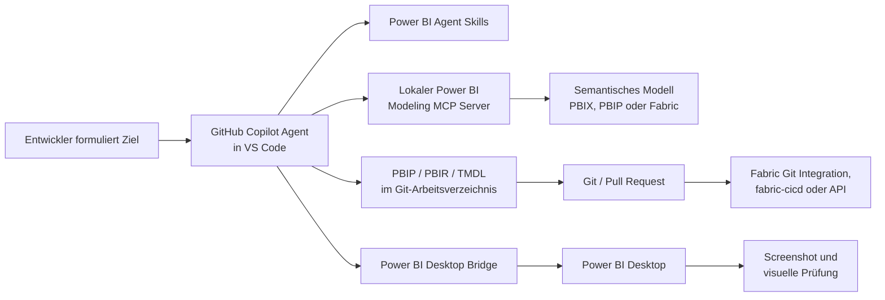
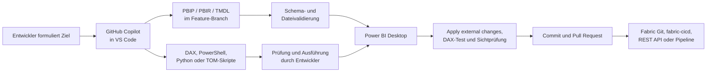

# Vibe Coding mit Power BI unter Windows

## Schulungsgrundlage zu Visual Studio Code, Visual Studio und agentischer BI-Entwicklung

> **Stand:** 19. August 2026  
> **Zielplattform:** Windows 10/11 mit Power BI Desktop  
> **Zielgruppe:** Power-BI-Entwickler, BI-Architekten, Data Analysts, DevOps-Verantwortliche und technische Trainer  
> **Hinweis zum Produktstatus:** Mehrere beschriebene Funktionen befinden sich in der Vorschau. Der Status sollte vor jeder Schulung anhand der verlinkten Microsoft-Learn-Seiten geprüft werden.

## 1. Kurzfassung

Vibe Coding mit Power BI ist unter Windows möglich. Microsoft verwendet den Begriff **Vibe Coding** in der Power-BI-Dokumentation nicht als offiziellen Produktnamen. Mit **Power BI Agentic**, **GitHub Copilot**, den **Power BI MCP Servern**, **Power BI Desktop Projects (PBIP)**, **PBIR**, **TMDL** und der **Power BI Desktop Bridge** existiert jedoch inzwischen ein von Microsoft dokumentierter agentischer Entwicklungsweg.

Kann oder darf ein Kunde keine MCP Server verwenden, bleibt ein eingeschränkter, dateibasierter Vibe-Coding-Ansatz möglich. VS Code beziehungsweise Visual Studio, GitHub Copilot, PBIP, PBIR, TMDL, DAX, Power BI Desktop, Git und CI/CD funktionieren ohne MCP. Nicht verfügbar sind dann der direkte Agentenzugriff auf das semantische Modell über den lokalen Modeling MCP Server und natürlichsprachliche Modellabfragen über den remote MCP Server. Abschnitt 7.5 beschreibt den empfohlenen No-MCP-Zielzustand.

Eine fachliche Anforderung kann dabei in natürlicher Sprache formuliert werden. Ein KI-Agent kann anschließend:

1. ein semantisches Modell untersuchen,
2. Tabellen, Beziehungen und Measures erstellen oder ändern,
3. DAX-Abfragen ausführen und Ergebnisse prüfen,
4. Berichtsseiten und Visuals in PBIR erzeugen,
5. Power BI Desktop neu laden,
6. Screenshots zur visuellen Prüfung aufnehmen,
7. Änderungen über Git nachvollziehbar machen und
8. Artefakte kontrolliert nach Microsoft Fabric bereitstellen.

Der empfohlene Arbeitsplatz besteht nicht nur aus einem Editor. Die Werkzeuge übernehmen unterschiedliche Aufgaben:

- **Power BI Desktop** rendert Berichte, verarbeitet lokale Modelle und bleibt die visuelle Prüf- und Autorenoberfläche.
- **Visual Studio Code** ist die bevorzugte Umgebung für KI-Agenten, MCP, PBIP/PBIR/TMDL, Git, Skripte und CI/CD-Dateien.
- **Visual Studio mit SSDT** ist eine spezialisierte Entwicklungsumgebung für Analysis-Services-Tabularmodelle und deren Deployment, aber kein Power-BI-Berichtsdesigner.

## 2. Lernziele

Nach Bearbeitung dieser Unterlage können Teilnehmende:

- den Begriff Vibe Coding auf Power BI übertragen und fachlich einordnen,
- Visual Studio Code und Visual Studio für Power-BI-Szenarien unterscheiden,
- die Rollen von PBIX, PBIP, PBIR und TMDL erklären,
- lokale und remote Power BI MCP Server unterscheiden,
- einen agentischen Änderungsablauf mit kontrollierten Freigabepunkten planen,
- geeignete Prompts für Modell-, DAX- und Berichtsentwicklung formulieren,
- Power BI Desktop Bridge für Reload und visuelle Validierung einordnen,
- Git- und CI/CD-Verfahren für Power-BI-Projekte beschreiben und
- Preview-, Sicherheits- und Qualitätsrisiken bewerten.

## 3. Was bedeutet Vibe Coding bei Power BI?

### 3.1 Arbeitsdefinition

In dieser Unterlage bedeutet **Vibe Coding mit Power BI**:

> Ein KI-gestützter Entwicklungsprozess, bei dem der Entwickler Ziele, fachliche Regeln und Qualitätskriterien überwiegend in natürlicher Sprache beschreibt und ein Agent daraus prüfbare Änderungen an semantischem Modell, DAX, Bericht oder Deployment-Automatisierung erzeugt.

Das Ergebnis bleibt Software beziehungsweise Metadaten und muss daher wie anderer Code behandelt werden: versionieren, prüfen, testen, freigeben und überwachen.

### 3.2 Was Vibe Coding nicht bedeutet

Vibe Coding bedeutet nicht:

- einen unklaren Prompt direkt in Produktion auszuführen,
- fachliche DAX-Ergebnisse nur auf syntaktische Gültigkeit zu prüfen,
- KI-generierte Visuals ohne Sichtprüfung zu akzeptieren,
- Berechtigungen, RLS oder Datenschutz an den Agenten zu delegieren,
- PBIR-JSON ohne Schema- oder Toolunterstützung frei zu erfinden oder
- Power BI Desktop vollständig durch Visual Studio Code zu ersetzen.

### 3.3 Reifegrad nach Aufgabe

| Aufgabe | Eignung für agentisches Arbeiten | Begründung |
| --- | --- | --- |
| Measures und DAX-Abfragen erzeugen | Hoch | Strukturierte Sprache, ausführbare Tests und klarer Modellkontext |
| Beschreibungen, Formatstrings und Metadaten ergänzen | Hoch | Gut automatisierbare, wiederholbare Änderungen |
| Tabellen, Beziehungen und Perspektiven ändern | Mittel bis hoch | Gut mit TMDL/MCP möglich, aber fachliche Modellprüfung erforderlich |
| Massenänderungen über viele Modellobjekte | Hoch | Bulk-Operationen und Transaktionen sind ein Kernfall des lokalen MCP Servers |
| Bestehende PBIR-Seite gezielt ändern | Mittel bis hoch | Öffentliche Schemas und Authoring Skill ermöglichen kontrollierte Änderungen |
| Bericht von Grund auf gestalten | Mittel | Agent kann planen und bauen; Layout, Lesbarkeit und Story müssen visuell geprüft werden |
| Power-Query-Transformationen erzeugen | Mittel | Technisch möglich, aber Datenprofil, Folding und Datenschutz müssen geprüft werden |
| Fachliche Freigabe und KPI-Definition | Niedrig | Verantwortlichkeit bleibt bei Fachbereich und Data Owner |
| Produktivdeployment ohne Review | Nicht empfohlen | Preview-Funktionen und destruktive Agentenoperationen erfordern Freigaben |

## 4. Windows als empfohlene Entwicklungsplattform

Power BI Desktop läuft auf Windows. Dadurch kann der vollständige lokale Agentenzyklus auf einem Rechner stattfinden:



### 4.1 Mindestvoraussetzungen von Power BI Desktop

Microsoft nennt unter anderem:

- Windows 10 oder Windows Server 2016 oder neuer,
- .NET Framework 4.7.2 oder neuer,
- Microsoft Edge beziehungsweise WebView2,
- mindestens 2 GB verfügbaren Arbeitsspeicher, 4 GB oder mehr empfohlen,
- mindestens 1440 × 900 beziehungsweise 1600 × 900 Bildschirmauflösung und
- einen 64-Bit-Prozessor.

Für Schulungsrechner ist Windows 11 mit mindestens 16 GB RAM sinnvoll, insbesondere wenn Power BI Desktop, VS Code, Git, Node.js und ein Browser gleichzeitig laufen.

### 4.2 Empfohlene Software

| Komponente | Zweck | Erforderlichkeit |
| --- | --- | --- |
| Power BI Desktop | Modellierung, Berichtscanvas, Rendering und Veröffentlichung | Erforderlich für den vollständigen lokalen Ablauf |
| Visual Studio Code | Agent, MCP, Dateien, Git, Skripte und Validierung | Empfohlen |
| Git | Versionierung, Branches, Diff und Rollback | Stark empfohlen |
| GitHub Copilot | Agentischer Dialog in VS Code | Erforderlich für den beschriebenen Copilot-Ablauf |
| GitHub Copilot CLI | Installation und Nutzung des Power-BI-Authoring-Plugins | Für den empfohlenen Plugin-Weg erforderlich |
| Node.js 18 oder neuer | Voraussetzung des Authoring-Plugins | Erforderlich laut Power BI Agentic-Dokumentation |
| Node.js 20 oder neuer | Ausführung des lokalen MCP Servers per `npx` | Für diesen Installationsweg erforderlich |
| TMDL-Erweiterung für VS Code | Syntaxunterstützung für TMDL | Empfohlen |
| Visual Studio mit Analysis Services Projects | Klassische Tabular-/SSDT-Projekte | Nur für entsprechende Enterprise-Szenarien |
| DAX Studio, ALM Toolkit oder Tabular Editor | Diagnose, Vergleich und erweiterte Modellierung | Optional |

## 5. Visual Studio Code und Visual Studio im Vergleich

### 5.1 Entscheidungsmatrix

| Kriterium | Visual Studio Code | Visual Studio mit SSDT |
| --- | --- | --- |
| Primäre Rolle | Leichter Codeeditor und Agentenhost | Integrierte Entwicklungsumgebung für Analysis Services |
| GitHub-Copilot-Agent und MCP | Zentraler, von Microsoft dokumentierter Power-BI-Agentic-Weg | MCP allgemein unterstützt, aber nicht der primäre dokumentierte Power-BI-Agentic-Weg |
| PBIP-Projektdateien | Sehr gut geeignet | Kein Schwerpunkt |
| PBIR-Berichtsdateien | JSON-Schema, IntelliSense, Agent Skills und Git | Kein Power-BI-Berichtsdesigner |
| TMDL | Offizielle Microsoft-TMDL-Erweiterung und textbasierte Bearbeitung | Tabularmodell über SSDT/Model Designer, traditionell `model.bim` |
| Power-BI-Berichtsseiten gestalten | Indirekt über PBIR und Agent Skills; Prüfung in Desktop | Nicht unterstützt |
| Semantisches Modell gestalten | TMDL, MCP, Skripte und externe Tools | Vollwertiger Tabular Model Designer für Analysis Services Projects |
| Power BI Desktop anbinden | Modeling MCP und Desktop Bridge | XMLA/Analysis Services und klassische externe Toolchains |
| Zielsysteme | Power BI Desktop, PBIP, Fabric-Workspaces | SSAS, Azure Analysis Services und Power BI Premium über XMLA |
| Quellcodeverwaltung | Native Git-Oberfläche, gut für kleine Textdateien | Azure DevOps/Git für SSDT-Solutions |
| CI/CD-Dateien | YAML, Python, PowerShell, Fabric CLI und `fabric-cicd` | Build/Deployment klassischer Analysis-Services-Projekte |
| Typischer Nutzer | Power-BI-Entwickler, Analyst, Analytics Engineer | BI-/Analysis-Services-Entwickler |
| Empfehlung für Vibe Coding | **Bevorzugte Oberfläche** | Ergänzung für spezielle Tabular-Enterprise-Szenarien |

### 5.2 Wann Visual Studio Code verwenden?

Visual Studio Code ist die richtige Wahl, wenn mindestens einer dieser Punkte zutrifft:

- Power-BI-Artefakte sollen als PBIP in Git gespeichert werden.
- Ein KI-Agent soll TMDL, DAX oder PBIR bearbeiten.
- Der lokale oder remote Power BI MCP Server soll mit GitHub Copilot verwendet werden.
- JSON-Schemas sollen PBIR-Dateien validieren.
- Massenänderungen oder projektübergreifende Suchen sind erforderlich.
- Deploymentskripte in Python, PowerShell oder YAML gehören zum Projekt.
- Pull Requests sollen verständliche Text-Diffs für Modell und Bericht zeigen.

### 5.3 Wann Visual Studio verwenden?

Visual Studio mit der Erweiterung **Analysis Services Projects** ist sinnvoll, wenn:

- ein eigenständiges Analysis-Services-Tabularmodell entwickelt wird,
- das Ziel SQL Server Analysis Services oder Azure Analysis Services ist,
- ein Tabularmodell direkt in einen Power BI Premium/Fabric-Workspace über XMLA bereitgestellt wird,
- ein klassisches SSDT-Projekt mit `model.bim`, Konfigurationen und Buildprozess vorhanden ist oder
- das Team bereits eine etablierte Visual-Studio-/Azure-DevOps-Toolchain betreibt.

Microsoft dokumentiert für ein Deployment in Power BI Premium:

- Visual Studio 2017 oder neuer,
- Analysis Services Projects Extension 2.9.14 oder neuer,
- Modell-Kompatibilitätslevel 1500 oder neuer,
- aktivierten XMLA-Lese-/Schreibzugriff im Workspace und
- die Workspace-Verbindungs-URL als Deployment Server.

Nach dem ersten Metadaten-Deployment müssen Datenquellen-Anmeldeinformationen im Power BI Service konfiguriert werden. Das direkte **Deploy** aus Visual Studio sollte laut Microsoft nicht als allgemeiner Produktionsprozess verwendet werden, weil Eigenschaften eines bestehenden Modells überschrieben werden können.

### 5.4 Der wesentliche Unterschied

Visual Studio und Visual Studio Code sind in diesem Szenario keine austauschbaren Varianten desselben Werkzeugs:

- **Visual Studio Code arbeitet datei-, agenten- und automationsorientiert.**
- **Visual Studio arbeitet projekt-, Designer- und Analysis-Services-orientiert.**

Für eine moderne Power-BI-Schulung zu Vibe Coding sollte VS Code das Hauptwerkzeug sein. Visual Studio gehört als Abgrenzung und als Vertiefung für zentral verwaltete semantische Modelle in die Unterlage.

## 6. Die Power-BI-Artefakte verstehen

### 6.1 PBIX

Eine `.pbix`-Datei bündelt Bericht, Modell und gegebenenfalls importierte Daten. Sie eignet sich gut für Power BI Desktop, aber schlecht für zeilenbasierte Git-Diffs und parallele Bearbeitung.

### 6.2 PBIP

Ein Power BI Project (`.pbip`) speichert Bericht und semantisches Modell in einer lesbaren Ordnerstruktur. PBIP ist laut Microsoft derzeit Preview.

```text
SalesAnalytics/
├── SalesAnalytics.pbip
├── SalesAnalytics.Report/
│   ├── definition.pbir
│   └── definition/
│       ├── pages/
│       ├── bookmarks/
│       └── report.json
├── SalesAnalytics.SemanticModel/
│   ├── definition.pbism
│   └── definition/
│       ├── model.tmdl
│       ├── tables/
│       ├── relationships.tmdl
│       └── roles.tmdl
└── .gitignore
```

Power BI Desktop erzeugt standardmäßig Einträge für lokale, nicht zu versionierende Dateien:

```gitignore
**/.pbi/localSettings.json
**/.pbi/cache.abf
```

### 6.3 TMDL

Die **Tabular Model Definition Language** beschreibt ein semantisches Modell textuell. Die TMDL View in Power BI Desktop ist allgemein verfügbar; die Webversion ist Preview.

TMDL eignet sich unter anderem für:

- Measures, Tabellen, Spalten und Beziehungen,
- Berechnungsgruppen,
- Perspektiven und Übersetzungen,
- Rollen und Metadaten,
- Suchen und Ersetzen über viele Objekte sowie
- wiederverwendbare Modellbausteine.

Beispiel für eine Perspektive aus Microsoft Learn:

```tmdl
createOrReplace
    perspective SalesView
        perspectiveTable Sales
            perspectiveMeasure 'Sales Amount'
            perspectiveMeasure 'Sales Qty'
            perspectiveColumn Quantity
            perspectiveColumn 'Amount'
```

### 6.4 PBIR

Das **Power BI Enhanced Report Format** speichert Seiten, Visuals und Bookmarks in getrennten JSON-Dateien. PBIR ist öffentlich dokumentiert, unterstützt JSON-Schemas und eignet sich dadurch für IntelliSense, Validierung, Diff und Merge. PBIR ist derzeit Preview.

Typische Automationsfälle:

- Seiten oder Visuals zwischen Berichten kopieren,
- Farben und Formatierungen über viele Visuals ändern,
- Visual-Level-Filter per Skript anpassen,
- veraltete Visualtypen ersetzen und
- wiederkehrende Berichtsvorlagen erzeugen.

PBIR sollte nicht aus dem Gedächtnis frei konstruiert werden. Für agentische Änderungen empfiehlt Microsoft den **Power BI Report Authoring Skill**, der die Schemas und Dateimechanik berücksichtigt.

## 7. Komponenten des agentischen Power-BI-Stacks

### 7.1 Power BI Agentic

Power BI Agentic ist kein Schalter in Power BI Desktop. Microsoft beschreibt es als kuratiertes Paket aus:

- Agent Skills, die Vorgehen und Best Practices vorgeben, und
- Tools, die Modelle untersuchen, DAX ausführen, PBIR bearbeiten und Desktop steuern.

Das empfohlene Plugin heißt `powerbi-authoring` und enthält unter anderem:

| Skill | Aufgabe |
| --- | --- |
| `semantic-model-authoring` | Modelle erstellen, ändern, deployen und optimieren |
| `power-bi-report-design` | Designbrief, Seitentyp, Diagrammwahl, Farbe und Layout |
| `power-bi-report-planner` | Anforderungen, Modellanalyse, Plan und Freigabepunkte |
| `powerbi-report-authoring` | PBIR-Seiten, Visuals, Filter, Themes und Validierung |
| `power-bi-report-management` | Berichte über Fabric APIs laden und verwalten |

Installation über GitHub Copilot CLI:

```powershell
copilot plugin marketplace add microsoft/skills-for-fabric
copilot plugin install powerbi-authoring@fabric-collection
```

Anschließend kann in Copilot CLI mit `/skills` geprüft werden, ob beispielsweise `semantic-model-authoring` geladen wurde. In VS Code kann das Plugin über die Agent-Customization-Oberfläche gesucht werden.

### 7.2 Lokaler Power BI Modeling MCP Server

Der lokale Server dient dem **Erstellen und Ändern** von semantischen Modellen. Er kann mit folgenden Zielen arbeiten:

- einem in Power BI Desktop geöffneten Modell,
- Power-BI-Projektdateien und
- semantischen Modellen in Fabric-Workspaces.

Kernfunktionen laut Microsoft:

- natürliche Sprachbefehle für Tabellen, Spalten, Measures und Beziehungen,
- Bulk-Operationen mit Transaktionen und Fehlerbehandlung,
- Anwendung von Modellierungs-Best-Practices,
- TMDL- und PBIP-Workflows sowie
- Ausführung und Validierung von DAX-Abfragen.

### 7.3 Remote Power BI MCP Server

Der remote Server dient primär dem **Abfragen und Analysieren** vorhandener semantischer Modelle. Er läuft als Fabric-Dienst und verwendet Microsoft Entra ID.

Workspace-Konfiguration in `.vscode/mcp.json`:

```json
{
  "servers": {
    "powerbi-remote": {
      "type": "http",
      "url": "https://api.fabric.microsoft.com/v1/mcp/powerbi"
    }
  }
}
```

Voraussetzungen:

- Aktivierung der Preview-Tenanteinstellung durch den Power-BI-Administrator,
- Visual Studio Code und GitHub Copilot,
- mindestens Build-Berechtigung auf dem semantischen Modell und
- für serverseitige DAX-Generierung eine passende Copilot-Berechtigung beziehungsweise Kapazität.

Der Server bietet Werkzeuge zum Abrufen des Modellschemas, zum Abrufen von Berichtsmetadaten, zum Generieren von DAX und zum Ausführen von DAX. Bei Benutzerauthentifizierung wird Row-Level Security durchgesetzt.

### 7.4 Power BI Desktop Bridge

Die Desktop Bridge ist ein lokaler Server innerhalb des Power-BI-Desktop-Prozesses. Sie kommuniziert über eine lokale Windows Named Pipe und JSON-RPC 2.0. Remotezugriff wird nicht unterstützt.

Die Bridge kann:

- offene Desktop-Instanzen und ungespeicherte Änderungen erkennen,
- PBIP/PBIX öffnen,
- PBIR-Änderungen neu laden,
- einzelne oder alle Berichtsseiten als PNG aufnehmen und
- einem Agenten eine visuelle Editier-Prüf-Schleife ermöglichen.

Wichtige CLI-Befehle:

```powershell
powerbi-desktop status
powerbi-desktop open .\SalesAnalytics.pbip
powerbi-desktop reload
powerbi-desktop screenshot <page-id>
powerbi-desktop screenshot-all
```

Die Preview-Funktion **Enable external tool access to Power BI Desktop through secure local APIs** muss in Power BI Desktop aktiviert sein. Sie ist laut Microsoft standardmäßig eingeschaltet.

### 7.5 Kundenbetrieb ohne MCP Server

#### Was entfällt?

Ein MCP-Verbot entfernt nicht Power BI oder KI-Unterstützung insgesamt. Es entfernt die standardisierte Verbindung, über die ein Agent Power-BI-Werkzeuge selbst entdecken und aufrufen kann.

| Fähigkeit | Mit MCP | Ohne MCP | Ersatz beziehungsweise Konsequenz |
| --- | --- | --- | --- |
| Modellstruktur automatisch untersuchen | Agent ruft Modellwerkzeuge auf | Kein direkter Agentenzugriff | TMDL-Dateien, dokumentierter Schemaexport oder manuell bereitgestellter Kontext |
| Measures direkt im geöffneten Modell anlegen | Lokaler Modeling MCP Server | Nicht direkt durch den Agenten | DAX/TMDL in VS Code erzeugen, prüfen und in TMDL View oder PBIP anwenden |
| DAX gegen Modell automatisch ausführen | MCP-Werkzeug führt Abfrage aus | Kein MCP-Aufruf | DAX Query View, DAX Studio, XMLA oder freigegebenes Testskript |
| Natürlichsprachliche Datenabfrage aus VS Code | Remote MCP Server | Entfällt | Copilot in Power BI, DAX Query View oder manuell ausgeführte DAX-Abfragen |
| PBIR-Dateien erzeugen | Authoring Skill plus Tools | Dateibasiert weiterhin möglich | Öffentliche PBIR-Schemas, genehmigte Skills ohne MCP oder kontrollierte Skripte |
| Bericht in Desktop neu laden | Desktop Bridge | Unverändert, sofern Bridge erlaubt | Banner **Apply external changes** als vollständig manuelle Alternative |
| Screenshot automatisieren | Desktop Bridge | Unverändert, sofern Bridge erlaubt | Manuelle Sichtprüfung und Screenshots, falls Bridge ebenfalls verboten ist |
| Git-Diff und Pull Request | Unabhängig von MCP | Unverändert | Kein Ersatz nötig |
| Deployment | MCP optional | Unverändert | Fabric Git Integration, `fabric-cicd`, REST API oder Deployment Pipeline |

#### Wichtig: Desktop Bridge ist kein MCP Server

Die Power BI Desktop Bridge verwendet laut Microsoft eine lokale Windows Named Pipe und JSON-RPC 2.0. Sie implementiert nicht das Model Context Protocol. Ein Verbot von **MCP Servern** schließt die Bridge daher technisch nicht automatisch ein.

Die Kundenrichtlinie muss dennoch präzisiert werden:

1. **Nur MCP verboten:** Desktop Bridge kann nach separater Sicherheitsfreigabe weiter für Reload und Screenshots verwendet werden.
2. **Alle lokalen Agenten- oder IPC-Dienste verboten:** Desktop Bridge deaktivieren; Reload über **Apply external changes** und Sichtprüfung manuell durchführen.
3. **Keine autonomen Schreibzugriffe erlaubt:** Agent darf nur Vorschläge oder Dateien in einem Feature-Branch erzeugen; ein Mensch wendet Änderungen an und gibt sie frei.

#### Empfohlene No-MCP-Architektur



Der Agent arbeitet dabei primär auf Dateien. Power BI Desktop und freigegebene Fachwerkzeuge bleiben die Ausführungs- und Prüfoberflächen.

#### Empfohlener Windows-Werkzeugstack ohne MCP

| Aufgabe | Bevorzugtes Werkzeug ohne MCP |
| --- | --- |
| Natürlichsprachliche Codeunterstützung | GitHub Copilot in VS Code oder Visual Studio |
| Semantisches Modell als Code | PBIP und TMDL in VS Code |
| Modelländerung im laufenden Desktop | TMDL View oder zugelassenes externes Tool |
| DAX generieren | GitHub Copilot oder Copilot in DAX Query View |
| DAX testen | DAX Query View, DAX Studio oder freigegebene XMLA-Abfrage |
| Bericht als Code | PBIR mit JSON-Schemas und kontrollierten Skripten |
| Bericht validieren | JSON-Schema, projektspezifische Prüfskripte und Power BI Desktop |
| Bericht neu laden | **Apply external changes** oder genehmigte Desktop Bridge |
| Visuell prüfen | Power BI Desktop, gegebenenfalls manuelle Screenshots |
| Versionieren | Git in VS Code oder Azure DevOps |
| Deployen | Power BI Desktop, Fabric Git Integration, `fabric-cicd`, REST API oder Deployment Pipeline |
| Enterprise-Tabularmodell | Visual Studio mit Analysis Services Projects/SSDT |

#### Power BI Agentic Plugin nicht ungeprüft installieren

Das Microsoft-Plugin `powerbi-authoring` registriert den Power BI Modeling MCP Server automatisch. Bei einem MCP-Verbot darf es deshalb nicht einfach mit der Standardinstallation ausgerollt werden.

Vor einer Nutzung ist zu klären, ob:

- nur einzelne Agent Skills ohne MCP-Komponente installiert werden dürfen,
- die Kundenrichtlinie Agent-Customization-Dateien zulässt,
- PBIR-Änderungen ausschließlich über eigene geprüfte Skripte erfolgen sollen oder
- Berichtserstellung auf Power BI Desktop und Copilot in Power BI beschränkt bleibt.

Die konservative Standardentscheidung lautet: **Plugin nicht installieren, solange die MCP-Komponente nicht nachweislich deaktiviert oder ausgeschlossen werden kann.**

#### No-MCP-Arbeitsablauf

1. Power BI Desktop speichert einen funktionierenden Stand als PBIP.
2. Git sichert die Baseline in einem Commit.
3. Der Entwickler stellt dem Agenten nur die benötigten PBIP-, TMDL- oder PBIR-Dateien als Kontext bereit.
4. Der Agent erstellt zunächst Plan und Diff, aber führt keine Power-BI-Operation selbst aus.
5. TMDL/DAX wird in TMDL View beziehungsweise DAX Query View angewendet und getestet.
6. PBIR-Änderungen werden schemavalidiert und in Desktop über **Apply external changes** geladen.
7. Der Entwickler prüft jede Berichtsseite visuell und hält Screenshots fest.
8. Ein Pull Request dokumentiert fachliche Tests, technische Validierung und Preview-Abhängigkeiten.
9. Deployment erfolgt über eine freigegebene Nicht-MCP-Schnittstelle.

#### Beispielprompt ohne MCP

```text
Du hast keinen direkten Zugriff auf Power BI Desktop, Fabric oder einen MCP Server.
Arbeite ausschließlich mit den bereitgestellten PBIP-, TMDL- und PBIR-Dateien.

Aufgabe:
- Analysiere die vorhandene Modellstruktur aus den TMDL-Dateien.
- Erstelle einen Änderungsvorschlag für [Umsatz Vorjahr] und [Umsatz YoY %].
- Ändere keine Beziehungen, Rollen, Datenquellen oder Power-Query-Ausdrücke.
- Liefere die TMDL-/DAX-Änderung und drei DAX-Testabfragen.
- Behaupte nicht, die Abfragen ausgeführt zu haben.
- Nenne erwartete Resultate und manuelle Prüfschritte in Power BI Desktop.
- Warte vor Dateiänderungen auf Freigabe.
```

Dieser letzte Punkt ist wichtig: Ohne ausführendes Werkzeug muss der Agent sauber zwischen **generiert**, **statisch validiert** und **tatsächlich im Modell ausgeführt** unterscheiden.

## 8. Empfohlener Entwicklungsablauf

### Phase 1: Anforderung und Abnahmekriterien

Vor dem Prompt müssen mindestens feststehen:

- Zielgruppe des Berichts,
- Geschäftsfragen,
- Definitionen der Kennzahlen,
- Filter- und Zeitlogik,
- Sicherheitsanforderungen,
- Layout- und Barrierefreiheitsvorgaben sowie
- messbare Abnahmekriterien.

### Phase 2: Baseline sichern

1. PBIX als PBIP speichern.
2. PBIR und TMDL aktivieren, soweit für das Szenario vorgesehen.
3. Projekt in Git initialisieren.
4. Funktionierenden Ausgangsstand committen.
5. Feature-Branch für die Agentenänderung erstellen.

### Phase 3: Modell untersuchen

Der Agent soll zuerst lesen und berichten:

```text
Untersuche das geöffnete Power-BI-Modell. Nimm noch keine Änderungen vor.

Dokumentiere:
- Tabellen und Granularität,
- Beziehungen und Filterrichtungen,
- vorhandene Measures,
- Datumstabellen,
- Rollen und RLS,
- mögliche Modellierungsprobleme,
- fehlende Objekte für die gewünschte Vertriebsanalyse.

Erstelle danach einen Änderungsplan mit Risiken und Testfällen.
```

### Phase 4: Kleine, überprüfbare Änderung

```text
Implementiere nur die Measures Umsatz, Umsatz Vorjahr und Wachstum %.

Anforderungen:
- Verwende explizite Measures.
- Nutze die vorhandene markierte Datumstabelle.
- Setze passende Formatstrings und deutsche Beschreibungen.
- Ändere keine Beziehungen oder Power-Query-Ausdrücke.
- Führe DAX-Testabfragen für Gesamtwert, Monatsfilter und Jahresvergleich aus.
- Zeige Diff und Testergebnisse vor dem nächsten Schritt.
```

### Phase 5: Bericht erzeugen oder ändern

```text
Erstelle eine PBIR-Seite "Management Overview" für die Geschäftsleitung.

Inhalt:
- Karten für Umsatz, Marge und Wachstum %,
- monatlicher Umsatztrend mit Vorjahresvergleich,
- Top-10-Produkte als horizontales Balkendiagramm,
- Slicer für Jahr, Region und Vertriebskanal.

Qualität:
- Verwende nur vorhandene Modellfelder und Measures.
- Nutze das registrierte Corporate Theme.
- Vermeide unnötige Visuals und Scrollen bei 16:9.
- Validiere die PBIR-Struktur.
- Lade den Bericht in Power BI Desktop neu.
- Erzeuge einen Screenshot und prüfe Überlappung, Lesbarkeit und leere Visuals.
```

### Phase 6: Technische und fachliche Validierung

Mindestens erforderlich:

- PBIR-/JSON-Schema-Validierung,
- TMDL- beziehungsweise Modellvalidierung,
- DAX-Testabfragen mit bekannten Sollwerten,
- Prüfung der Filterkontexte,
- RLS-Test mit geeigneten Rollen,
- Performanceprüfung relevanter Visuals,
- Screenshotprüfung aller geänderten Seiten und
- fachliche Freigabe der Kennzahlen.

### Phase 7: Review und Deployment

1. Git-Diff prüfen.
2. Nicht beabsichtigte Änderungen entfernen.
3. Pull Request mit fachlicher Beschreibung und Screenshots erstellen.
4. Automatisierte Prüfungen ausführen.
5. Zuerst in einen Entwicklungs- oder Testworkspace deployen.
6. Smoke Test und fachliche Abnahme durchführen.
7. Erst danach Produktion aktualisieren.

## 9. Praxisbeispiele für die Schulung

### Übung 1: DAX mit lokalem MCP erstellen und prüfen

**Ziel:** Ein Agent ergänzt drei Measures in einem geöffneten Desktop-Modell.

**Ausgangslage:** Sternschema mit `Sales`, `Date`, `Product` und `Customer`.

**Prompt:**

```text
Analysiere zuerst das Modell und identifiziere die vorhandene Umsatzspalte
sowie die aktive Beziehung zur Datumstabelle.

Erstelle danach:
1. [Umsatz]
2. [Umsatz Vorjahr]
3. [Umsatz YoY %]

Nutze DIVIDE für die Prozentberechnung. Setze Formatstrings und
Beschreibungen. Führe anschließend DAX-Abfragen für zwei ausgewählte Jahre
aus und erkläre, warum die Ergebnisse plausibel sind.
```

**Prüfpunkte:**

- Wurde die richtige Faktenspalte verwendet?
- Ist die Datumstabelle markiert und lückenlos?
- Funktioniert die Filterweitergabe?
- Liefert das erste Jahr erwartungsgemäß keinen oder einen definierten Vorjahreswert?
- Sind Formatstrings und Beschreibungen gesetzt?

**No-MCP-Variante:** Der Agent erzeugt DAX und TMDL aus den Projektdateien. Die Teilnehmenden wenden die Änderung in TMDL View an und führen die Testabfragen in DAX Query View selbst aus. Das Testergebnis wird anschließend dem Agenten für die Auswertung bereitgestellt.

### Übung 2: TMDL-Massenänderung mit Planfreigabe

**Ziel:** Technische Schlüssel ausblenden und Beschreibungen ergänzen.

**Prompt:**

```text
Untersuche alle Modellspalten. Erstelle zunächst nur eine Vorschlagsliste.

Kandidaten zum Ausblenden sind technische Primär- und Fremdschlüssel,
die auf "Key", "ID" oder "_SK" enden. Blende keine fachlich benötigten
Identifikatoren aus. Ändere keine sourceColumn-Eigenschaften.

Erzeuge nach meiner Freigabe eine transaktionale Änderung und liefere
eine Liste aller geänderten Objekte.
```

**Lernpunkt:** Ein breit formulierter Prompt wird durch Vorschau, Ausschlussregeln und Freigabe kontrollierbar.

### Übung 3: Bericht mit PBIR und Desktop Bridge

**Ziel:** Eine neue Übersichtsseite erstellen und visuell prüfen.

**Ablauf:**

1. Bericht als PBIP/PBIR bereitstellen.
2. Agent analysiert Modell und vorhandenes Theme.
3. Report Design Skill erzeugt einen Designbrief.
4. Report Authoring Skill erstellt die PBIR-Dateien.
5. `validate-report` prüft die Struktur.
6. Desktop Bridge lädt die Dateien neu.
7. `screenshot` oder `screenshot-all` erzeugt Bilder.
8. Agent und Mensch prüfen Layout und fachliche Aussage.

**Review-Prompt:**

```text
Prüfe den Screenshot wie ein unabhängiger Power-BI-Reviewer.

Bewerte:
- visuelle Hierarchie,
- Leserichtung,
- Überlappungen und abgeschnittene Texte,
- konsistente Zahlenformate,
- Farbkontrast und Barrierefreiheit,
- angemessene Diagrammwahl,
- leere oder fehlerhafte Visuals,
- Eignung für 1366 × 768 und 1920 × 1080.

Nenne zuerst konkrete Befunde. Ändere noch keine Dateien.
```

### Übung 4: Remote MCP für Datenfragen

**Ziel:** Ein veröffentlichtes Modell aus VS Code untersuchen, ohne es zu ändern.

**Setup:** Remote MCP Server konfigurieren und Modell-ID bereitstellen.

**Prompts:**

```text
Welche Tabellen, Beziehungen und expliziten Measures enthält das Modell
mit der ID <semantic-model-id>?
```

```text
Zeige die zehn Produkte mit dem höchsten Umsatz im letzten vollständigen
Quartal. Erzeuge zuerst die DAX-Abfrage, erkläre den Filterkontext und führe
sie danach aus.
```

```text
Vergleiche Umsatz und Marge nach Region mit dem Vorjahresquartal.
Kennzeichne Regionen mit sinkendem Umsatz bei gleichzeitig steigender Marge.
```

**Lernpunkt:** Der remote Server ist ein Analysewerkzeug. Modelländerungen gehören zum lokalen Modeling MCP Server oder zu anderen Authoring-Schnittstellen.

**Bei MCP-Verbot:** Diese Übung entfällt. Als Ersatz wird dieselbe Geschäftsfrage mit Copilot in der DAX Query View oder mit einer von GitHub Copilot erzeugten und anschließend manuell ausgeführten DAX-Abfrage bearbeitet. Dadurch wird zugleich der Unterschied zwischen Codegenerierung und kontrollierter Ausführung sichtbar.

### Übung 5: Deployment mit `fabric-cicd`

Microsoft beschreibt `fabric-cicd` als offiziell unterstützte, Microsoft-gestützte Open-Source-Pythonbibliothek für codebasierte Fabric-Deployments.

Installation:

```powershell
python -m pip install fabric-cicd
```

Typischer Projektaufbau:

```text
my-powerbi-project/
├── SalesAnalytics.Report/
│   ├── definition.pbir
│   └── definition/
├── SalesAnalytics.SemanticModel/
│   ├── definition.pbism
│   └── definition/
├── SalesAnalytics.pbip
└── deploy.py
```

Aufruf nach Microsoft-Learn-Muster:

```powershell
python .\deploy.py --workspace_name "PBIP Fabric CICD Dev"
```

Für die Schulung sollte die Pipeline mindestens folgende Stufen enthalten:

1. Syntax- und Schemavalidierung,
2. Modell- und Berichtsprüfung,
3. Deployment in einen Entwicklungsworkspace,
4. Smoke Tests,
5. manuelle Freigabe und
6. Deployment in Test beziehungsweise Produktion.

## 10. Prompt Engineering für Power BI

### 10.1 Ein gutes Promptmuster

Ein belastbarer Power-BI-Prompt enthält:

1. **Rolle und Ziel:** Wer nutzt das Ergebnis und welche Entscheidung soll unterstützt werden?
2. **Kontext:** Welches Modell, welcher Bericht oder welche Dateien sind betroffen?
3. **Scope:** Welche Objekte dürfen geändert werden?
4. **Ausschlüsse:** Welche Objekte oder Eigenschaften dürfen nicht geändert werden?
5. **Fachregeln:** Definitionen, Zeitlogik, Rundung und Sonderfälle.
6. **Qualitätskriterien:** Formatstrings, Namenskonventionen, Performance und Barrierefreiheit.
7. **Validierung:** Welche Abfragen, Sollwerte und Screenshots werden erwartet?
8. **Freigabepunkt:** Wann muss der Agent vor weiteren Änderungen stoppen?

### 10.2 Schwacher und verbesserter Prompt

Schwach:

```text
Baue mir ein gutes Sales Dashboard.
```

Verbessert:

```text
Erstelle zunächst einen Design- und Implementierungsplan für eine
16:9-Berichtsseite für die Vertriebsleitung. Noch keine Dateien ändern.

Geschäftsfragen:
- Wie entwickeln sich Umsatz und Marge gegenüber Vorjahr?
- Welche Regionen verfehlen ihr Ziel?
- Welche Produkte treiben die Abweichung?

Verwende nur explizite Measures des vorhandenen Modells. Falls Kennzahlen
fehlen, liste sie getrennt auf. Plane höchstens sechs Visuals, berücksichtige
deutsche Zahlenformate, Farbfehlsichtigkeit und eine klare Leserichtung.

Definiere für jede Kennzahl einen fachlichen Testfall. Warte danach auf
meine Freigabe.
```

### 10.3 Schutzprompt für bestehende Projekte

```text
Arbeite ausschließlich im aktuellen Feature-Branch.

Vor jeder Änderung:
- prüfe den Git-Status,
- melde ungespeicherte Änderungen in Power BI Desktop,
- erstelle einen Plan und nenne die betroffenen Dateien.

Verboten ohne ausdrückliche Freigabe:
- Löschen von Tabellen, Measures, Seiten oder Rollen,
- Ändern von Datenquellen und Anmeldeinformationen,
- Ändern von RLS/OLS,
- Veröffentlichung in Produktionsworkspaces,
- Überschreiben manueller Änderungen.

Nach jeder Änderung:
- validiere TMDL/PBIR,
- führe die vereinbarten DAX-Tests aus,
- erzeuge einen Diff,
- lade Power BI Desktop neu und prüfe Screenshots.
```

## 11. Qualitätssicherung

### 11.1 Modellqualität

- Sternschema und eindeutige Granularität prüfen.
- Beziehungen, Kardinalität und Filterrichtung kontrollieren.
- Explizite statt implizite Measures bevorzugen.
- Datumstabelle und Zeitintelligenz prüfen.
- Technische Spalten aus der Berichtsoberfläche ausblenden.
- Namen, Beschreibungen, Ordner und Formatstrings vereinheitlichen.
- RLS/OLS und Perspektiven nicht als austauschbare Konzepte behandeln.

### 11.2 DAX-Qualität

- Ergebnisse gegen bekannte Werte oder SQL-Abfragen prüfen.
- Gesamtzeilen und Teilmengen testen.
- leere Mengen, Division durch null und erstes Vergleichsjahr testen.
- Filterkontext und Beziehungspfad erklären lassen.
- Performance mit realistischen Filtern messen.
- KI-generierten Code fachlich verstehen, bevor er übernommen wird.

Microsoft weist ausdrücklich darauf hin, dass Copilot-generiertes DAX trotz Parser- und Syntaxprüfung inhaltlich validiert und verstanden werden muss.

### 11.3 Berichtsqualität

- PBIR strukturell validieren.
- jede geänderte Seite rendern und als Screenshot prüfen.
- Textüberlauf, Überlappungen und unlesbare Achsen ausschließen.
- Zahlenformate, Einheiten und Dezimalstellen vereinheitlichen.
- Tab-Reihenfolge, Alt-Texte, Kontrast und Farbfehlsichtigkeit berücksichtigen.
- Filter, Interaktionen, Drillthrough, Bookmarks und mobile Ansichten testen.

### 11.4 Git-Review

Der Pull Request sollte enthalten:

- fachliches Ziel,
- betroffene Modell- und Berichtsobjekte,
- Screenshots vorher/nachher,
- DAX-Testfälle und Ergebnisse,
- bekannte Einschränkungen,
- Preview-Abhängigkeiten und
- Rollback-Hinweise.

## 12. Sicherheit und Governance

### 12.0 Governance bei einem MCP-Verbot

Ein MCP-Verbot reduziert die Zahl direkter Agentenwerkzeuge und damit die Gefahr autonomer Modelländerungen. Es beseitigt jedoch nicht die Risiken generativer KI. PBIP-, TMDL- und PBIR-Dateien können Modellnamen, Kennzahllogik, Rollen, Datenquellenmetadaten und andere schützenswerte Informationen enthalten.

Auch ohne MCP sind deshalb zu regeln:

- welche Projektdateien GitHub Copilot als Kontext erhalten darf,
- ob Cloud- oder nur unternehmensverwaltete Modelle zulässig sind,
- ob generierte Skripte lokale oder Fabric-Schnittstellen aufrufen dürfen,
- wer Änderungen ausführt und fachlich freigibt,
- welche Logs und Pull-Request-Nachweise aufzubewahren sind und
- ob Desktop Bridge, REST API, XMLA und externe Tools separat freigegeben sind.

### 12.1 Berechtigungen

MCP-Agenten handeln mit den Berechtigungen des authentifizierten Benutzers oder Service Principals. Least Privilege ist deshalb Pflicht.

Empfehlungen:

- getrennte Entwicklungs-, Test- und Produktionsworkspaces,
- keine Adminrolle für alltägliches Authoring,
- Service Principals nur mit benötigten Workspace-Rollen,
- Produktionsdeployment nur über kontrollierte Pipeline,
- explizite Bestätigung destruktiver Operationen und
- Audit von Agentenaktionen, Git-Commits und Deployments.

### 12.2 Daten und Compliance

Microsoft weist darauf hin, dass MCP-Clients und gewählte Modellanbieter Daten außerhalb der Fabric-Compliancegrenzen verarbeiten können. Vor einer Einführung sind zu klären:

- welche Metadaten und Datenwerte an das Sprachmodell gelangen,
- welche Vertrags- und Datenverarbeitungsbedingungen gelten,
- ob sensible Modellnamen oder Abfrageergebnisse übertragen werden,
- welche regionalen und regulatorischen Vorgaben einzuhalten sind und
- ob eine Sicherheitsprüfung des MCP-Clients und der Serverkonfiguration erfolgt ist.

### 12.3 Row-Level Security

Beim remote MCP Server wird RLS für Benutzerauthentifizierung durchgesetzt. Microsoft nennt eine Einschränkung für Service-Principal-Authentifizierung. Sicherheitsverhalten muss daher mit echten Rollen und Identitäten getestet werden und darf nicht aus einer erfolgreichen Administratorabfrage abgeleitet werden.

## 13. Grenzen und Preview-Risiken

| Bereich | Einschränkung oder Risiko |
| --- | --- |
| Power BI MCP Server | Lokal und remote derzeit Public Preview; Tools und Schemas können sich ändern |
| Kundenbetrieb ohne MCP | Direkte Modellerkundung, Agentenaktionen und Remote-Datenchat entfallen; mehr manuelle Übergaben und Prüfungen |
| PBIP | Preview; nicht jede Datei darf extern bearbeitet werden |
| PBIR | Preview; Format und Schemaversionen entwickeln sich weiter |
| Agent Skills | Preview und stärker für GitHub Copilot CLI optimiert; VS-Code-Kompatibilität vorhanden |
| Desktop Bridge | Preview, nur lokal, Named Pipe, keine Remoteverbindung |
| Gleichzeitiges Arbeiten | Ungespeicherte Desktop- und externe Änderungen können sich überschreiben |
| Reload | Lädt Bericht oder Modell vollständig; Filter und UI-Zustände können zurückgesetzt werden |
| Nicht unterstützte Dateien | Unter anderem `definition.pbir`, `mobileState.json` und bestimmte Legacy-/Layoutdateien nicht extern ändern |
| Pfadlänge | PBIP-Projektpfade unter Windows unter 260 Zeichen halten |
| Visuelle Qualität | Valides PBIR garantiert kein gutes oder lesbares Layout |
| DAX | Syntaktisch gültig bedeutet nicht fachlich korrekt |

Beim Wechsel zwischen Power BI Desktop und VS Code gilt:

1. Änderungen in Power BI Desktop speichern.
2. Erst danach Dateien extern ändern.
3. Externe Änderungen über das Banner **Apply external changes** oder die Desktop Bridge laden.
4. Bei ungespeicherten Desktop-Änderungen nicht blind neu laden.

## 14. Vorschlag für eine Schulungsagenda

### Variante: eintägige Einführung

| Zeit | Modul | Inhalt |
| --- | --- | --- |
| 09:00–09:30 | Einordnung | Vibe Coding, Agenten, Grenzen und Zielarchitektur |
| 09:30–10:15 | Werkzeuge | Power BI Desktop, VS Code, Visual Studio und Artefaktformate |
| 10:15–10:30 | Pause |  |
| 10:30–11:30 | Modell als Code | PBIP, TMDL, Git und DAX-Beispiel |
| 11:30–12:15 | Integrationsvarianten | MCP als Referenzarchitektur, Kundenbetrieb ohne MCP und Ersatzworkflows |
| 12:15–13:00 | Mittag |  |
| 13:00–14:15 | Agentisches Authoring | Design, Planner, Authoring Skill und PBIR |
| 14:15–14:30 | Pause |  |
| 14:30–15:30 | Praxis | Berichtsseite erzeugen, reloaden und Screenshot prüfen |
| 15:30–16:15 | ALM | Git, Pull Requests, `fabric-cicd` und Deployment |
| 16:15–16:45 | Governance | Berechtigungen, RLS, Compliance und Preview-Risiken |
| 16:45–17:00 | Abschluss | Checkliste und Transferaufgabe |

### Benötigte Schulungsumgebung

- Windows-11-Rechner pro Teilnehmer oder Zweierteam,
- aktuelle Power BI Desktop-Version,
- Visual Studio Code und Git,
- GitHub Copilot und Copilot CLI,
- Node.js,
- Power-BI-Authoring-Plugin,
- Beispielprojekt als PBIP/PBIR/TMDL,
- Git-Repository mit Ausgangs-Tag,
- Fabric-Entwicklungsworkspace und
- Testmodell ohne personenbezogene oder vertrauliche Daten.

## 15. Checkliste für einen Pilotbetrieb

### Technik

- [ ] Power BI Desktop und Preview-Funktionen geprüft
- [ ] VS Code, GitHub Copilot, Copilot CLI und Node.js installiert
- [ ] Power-BI-Authoring-Plugin geladen
- [ ] Lokaler MCP Server erreichbar
- [ ] Bei MCP-Verbot: MCP-Konfigurationen und automatische Plugin-Registrierung ausgeschlossen
- [ ] Bei MCP-Verbot: zulässige Ersatzschnittstellen dokumentiert
- [ ] Desktop Bridge Status und Screenshot getestet
- [ ] PBIP/PBIR/TMDL-Projekt in Git versioniert
- [ ] Entwicklungsworkspace vorhanden

### Governance

- [ ] Datenklassifizierung durchgeführt
- [ ] MCP-/LLM-Datenflüsse bewertet
- [ ] Least-Privilege-Rollen eingerichtet
- [ ] Verbotene Agentenoperationen definiert
- [ ] Review- und Freigabeverfahren dokumentiert
- [ ] Preview-Risiko akzeptiert oder Pilot isoliert

### Qualität

- [ ] Fachliche Sollwerte vorhanden
- [ ] DAX-Testfälle definiert
- [ ] PBIR-/TMDL-Validierung automatisiert
- [ ] Screenshotprüfung vorgesehen
- [ ] RLS mit Testidentitäten geprüft
- [ ] Rollback über Git und Deploymentprozess getestet

## 16. Microsoft-Learn-Beispiele und Vertiefung

### Agentisches Power BI und MCP

- [Power BI Agentic overview](https://learn.microsoft.com/power-bi/developer/agentic/power-bi-agentic-overview)  
  Einstieg in Skills, Modeling MCP Server, Report Authoring und Desktop Bridge.
- [Overview of the Power BI MCP servers](https://learn.microsoft.com/power-bi/developer/mcp/mcp-servers-overview)  
  Vergleich des lokalen und remote MCP Servers einschließlich Sicherheitshinweisen.
- [Get started with remote Power BI MCP server](https://learn.microsoft.com/power-bi/developer/mcp/remote-mcp-server-get-started)  
  VS-Code-Konfiguration, Authentifizierung, Modell-ID und erste Abfragen.
- [Power BI MCP server remote tools](https://learn.microsoft.com/power-bi/developer/mcp/remote-mcp-server-tools)  
  Schema-, Report-Metadata-, DAX-Generierungs- und Ausführungswerkzeuge.
- [Power BI Modeling MCP Server auf GitHub](https://github.com/microsoft/powerbi-modeling-mcp)  
  Installation und technische Details des lokalen Servers.

### Berichtserstellung mit Agent Skills

- [Power BI Report Authoring skill](https://learn.microsoft.com/power-bi/developer/agentic/power-bi-report-authoring-skill-overview)  
  PBIR-Erstellung, Validierung und Zusammenspiel mit Modell und Desktop.
- [Power BI Report Design skill](https://learn.microsoft.com/power-bi/developer/agentic/power-bi-report-design-skill-overview)  
  Designbrief, Diagrammwahl, Farbe, Typografie und Layout.
- [Power BI Report Planner and Management skills](https://learn.microsoft.com/power-bi/developer/agentic/power-bi-planner-fabric-skill-overview)  
  Kontrollierter Ablauf von Anforderungen bis Fabric-Publishing.
- [Power BI Desktop Bridge](https://learn.microsoft.com/power-bi/developer/agentic/power-bi-desktop-bridge-overview)  
  Reload, Status, Screenshots, Named Pipe und CLI.
- [Skills for Fabric](https://github.com/microsoft/skills-for-fabric)  
  Microsoft-Katalog der Agent Skills und das `powerbi-authoring`-Plugin.

### PBIP, PBIR, TMDL und VS Code

- [Power BI Desktop projects](https://learn.microsoft.com/power-bi/developer/projects/projects-overview)  
  PBIP-Struktur, Git, externe Bearbeitung und Deploymentoptionen.
- [Edit PBIP files externally](https://learn.microsoft.com/power-bi/developer/projects/projects-external-editing)  
  Wechsel zwischen Power BI Desktop und VS Code sowie Reload-Verhalten.
- [Power BI Desktop project report folder und PBIR](https://learn.microsoft.com/power-bi/developer/projects/projects-report#pbir-format)  
  PBIR-Struktur, JSON-Schemas und Automationsfälle.
- [Power BI Desktop project semantic model folder](https://learn.microsoft.com/power-bi/developer/projects/projects-dataset#tmdl-format)  
  TMDL-Dateistruktur und VS-Code-Erweiterung.
- [Work with TMDL view](https://learn.microsoft.com/power-bi/transform-model/desktop-tmdl-view)  
  GA-Editor in Desktop und Beispiele für Wiederverwendung, Umbenennung und Perspektiven.
- [Create calculation groups](https://learn.microsoft.com/power-bi/transform-model/calculation-groups)  
  Berechnungsgruppen über Modellansicht und TMDL.
- [Power BI Desktop projects Git integration](https://learn.microsoft.com/power-bi/developer/projects/projects-git)  
  Lokales Git-Repository und Diffs in VS Code.
- [Power BI Desktop projects Azure DevOps integration](https://learn.microsoft.com/power-bi/developer/projects/projects-azdo)  
  Repository und Zusammenarbeit mit Azure DevOps.

### Visual Studio und Analysis Services

- [Semantic model connectivity with the XMLA endpoint](https://learn.microsoft.com/fabric/enterprise/powerbi/service-premium-connect-tools)  
  Visual Studio/SSDT, XMLA-Endpunkt und Deployment in Premium-Workspaces.
- [Analysis Services tools](https://learn.microsoft.com/analysis-services/tools-and-applications-used-in-analysis-services)  
  Analysis Services Projects Extension und unterstützte Werkzeuge.
- [Tabular modeling overview](https://learn.microsoft.com/analysis-services/tabular-models/tabular-models-ssas)  
  Tabular Model Designer, Zielplattformen und Modellkonzepte.
- [Deploy a tabular model from Visual Studio](https://learn.microsoft.com/analysis-services/deployment/deploy-from-visual-studio-tabular)  
  Deploymenteigenschaften und Verarbeitung.
- [Tabular model solution deployment](https://learn.microsoft.com/analysis-services/deployment/tabular-model-solution-deployment)  
  Vergleich von Deploymentmethoden und Produktionshinweise.

### Copilot, DAX und End-to-End-Beispiele

- [End-to-end: From raw data to a shared Power BI app](https://learn.microsoft.com/power-bi/create-reports/tutorial-end-to-end-power-bi)  
  Vollständiges Microsoft-Tutorial mit TMDL-Schnellweg sowie optionalem Copilot-/MCP-Pfad.
- [Use Copilot with semantic models](https://learn.microsoft.com/power-bi/create-reports/copilot-semantic-models)  
  DAX, Modellbeschreibungen, Datenfragen und Qualitätsanforderungen.
- [Write DAX queries with Copilot](https://learn.microsoft.com/dax/dax-copilot)  
  Promptbeispiele und verantwortungsvolle Verwendung von generiertem DAX.
- [Create and edit Power BI reports with Copilot](https://learn.microsoft.com/power-bi/create-reports/copilot-create-reports)  
  Berichtsseiten und Visuals mit Copilot im Power-BI-Produkt.
- [Prepare semantic models for AI](https://learn.microsoft.com/power-bi/create-reports/copilot-prepare-data-ai)  
  Modellvorbereitung für bessere Copilot- und MCP-Ergebnisse.

### Git, CI/CD und Deployment

- [Deploy PBIP using fabric-cicd](https://learn.microsoft.com/power-bi/developer/projects/projects-deploy-fabric-cicd)  
  Lokales Deployment, Parametrisierung, Azure Pipelines und GitHub Actions.
- [What is CI/CD in Microsoft Fabric?](https://learn.microsoft.com/fabric/cicd/cicd-overview)  
  Git-Synchronisierung, Service Principals, Fabric CLI und `fabric-cicd`.
- [Fabric CI/CD concepts and best practices](https://learn.microsoft.com/fabric/fundamentals/understand-best-practices-fabric-cicd)  
  Deployment Pipelines, Git und API-basierte Verfahren im Vergleich.
- [Fabric Git integration](https://learn.microsoft.com/fabric/cicd/git-integration/intro-to-git-integration)  
  Verbindung zwischen Fabric-Workspace und GitHub beziehungsweise Azure DevOps.

## 17. Fazit

Vibe Coding mit Power BI ist unter Windows inzwischen ein realer, von Microsoft dokumentierter Entwicklungsansatz. Der stärkste Nutzen entsteht bei strukturierten, prüfbaren Aufgaben: Modellmetadaten, DAX, Massenänderungen, PBIR-Automation und CI/CD.

Für Schulung und Pilotbetrieb ist folgende Rollenverteilung empfehlenswert:

- **VS Code** als Agenten-, Code-, Git- und Automationszentrale,
- **Power BI Desktop** als Laufzeit-, Modellierungs- und visuelle Prüfumgebung,
- **Visual Studio mit SSDT** als Spezialwerkzeug für klassische Analysis-Services-Tabularmodelle und XMLA-Deployments sowie
- **Fabric** als kontrollierte Zielplattform mit getrennten Umgebungen und CI/CD.

Der produktive Qualitätsgewinn entsteht nicht durch möglichst autonome Prompts, sondern durch einen kurzen, wiederholbaren Zyklus:

> Anforderung präzisieren → Modell untersuchen → Änderung planen → klein implementieren → technisch testen → visuell prüfen → fachlich freigeben → versioniert deployen.

Bei einem Kunden ohne MCP verschiebt sich dieser Zyklus von **Agent führt Werkzeuge aus** zu **Agent erzeugt prüfbare Dateien und Vorschläge**. Der Ansatz bleibt für TMDL, DAX, PBIR, Git und CI/CD wertvoll, benötigt aber mehr manuelle Ausführungsschritte. VS Code bleibt die bevorzugte KI- und Dateiumgebung; Power BI Desktop beziehungsweise Visual Studio/SSDT übernehmen Anwendung, Ausführung und Prüfung.